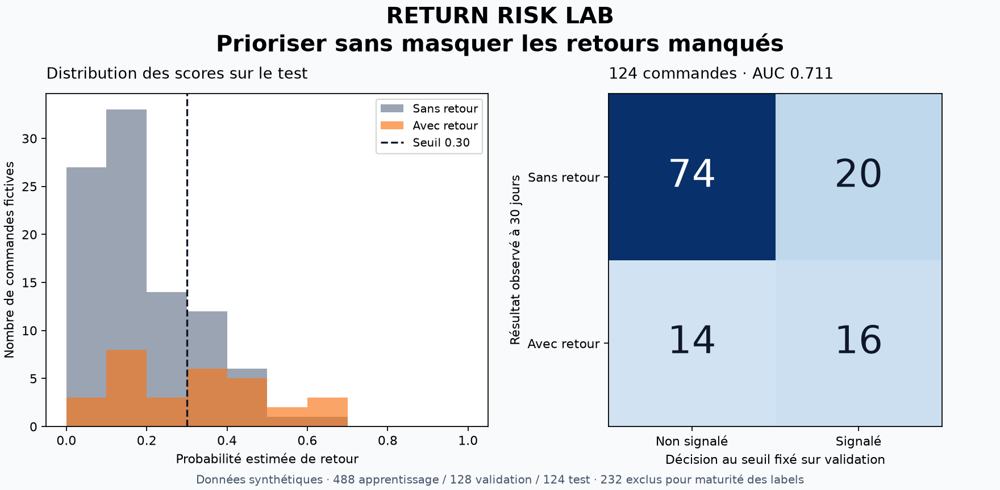

# Return Risk Lab

**Prioriser une analyse des retours produits sans utiliser des informations encore inconnues.** Un projet de classification tabulaire qui estime, au moment de la livraison, la probabilité de retour dans les 30 jours suivants.

Régression logistique explicable, référence constante, séparation chronologique avec délai de disponibilité des labels, seuil choisi sur validation et audit du test. Moteur en Python standard uniquement ; aucune API et aucune donnée personnelle.



## Cas métier

Une équipe opérations souhaite prioriser l'étude des commandes susceptibles de générer un retour. Les seules variables utilisées sont connues à la livraison : remise, retard constaté, caractère fragile du produit et prix. Le projet n'utilise ni identité client, ni motif de retour, ni remboursement, ni information postérieure au moment du score.

Il produit un score et un indicateur de priorité. Aucune commande, communication client ou intervention réelle n'est déclenchée. Le score ne prouve pas qu'une intervention empêcherait un retour.

## Démarrer

Python 3.10+ pour le moteur, validé avec Python 3.14.3 sous Windows.

```sh
git clone https://github.com/abdelouahabmoulinepro-coder/return-risk-lab.git
cd return-risk-lab
python risk.py --output build
python -m unittest discover -s tests -v
python predict_orders.py --artifact build/results.json
```

`predict_orders.py` utilise les deux commandes fictives **sans label** de `data/new_orders.json`, le modèle figé et le seuil de validation. Il ne réentraîne rien. Pour un autre fichier : `python predict_orders.py mes_commandes.json --artifact build/results.json`.

Le jeu principal est fourni ; `python generate_demo.py` le régénère à l'identique. Consulter [le rapport](example/report.md) et [l'artefact complet](example/results.json).

Figure facultative, nécessitant Python 3.11+ :

```sh
python -m pip install -r requirements-plot.txt
python plot_results.py build/results.json --output build/return-risk-audit.png
```

## Résultats réellement mesurés

Test : **124 commandes fictives, dont 30 retours**.

| Indicateur | Prévalence constante | Régression logistique |
|---|---:|---:|
| AUC | 0,500 | **0,711** |
| Score de Brier (plus faible = meilleur) | 0,184 | **0,161** |
| Log-loss (plus faible = meilleur) | 0,554 | **0,497** |
| Seuil choisi sur validation | 0,20 | 0,30 |
| Commandes signalées | 124 | 36 |
| Retours détectés | 30 / 30 | 16 / 30 |
| Fausses alertes | 94 | 20 |
| Retours manqués | 0 | **14** |
| Précision parmi les signalements | 24,2 % | 44,4 % |
| Rappel | 100 % | 53,3 % |
| Coût hypothétique FP + 5 × FN | 94 | 90 |

Le modèle réduit le nombre de signalements et améliore le classement, mais manque presque la moitié des retours. L'amélioration du coût hypothétique est faible : **4 unités sur ce seul échantillon**, pas un gain financier démontré. Un autre coût des retours manqués pourrait conduire à une décision différente.

## Labels à maturité et découpage chronologique

Une commande est étiquetée `returned_30d` seulement lorsque **30 jours se sont écoulés depuis sa livraison**. Pour éviter de considérer trop tôt une commande comme « sans retour », le modèle applique cette disponibilité avant chaque frontière.

| Bloc | Livraisons incluses dans la démo | Labels connus au plus tard le | Nombre |
|---|---|---|---:|
| Apprentissage | 01/01/2026–02/05/2026 | 01/06/2026 | 488 |
| Validation | 01/06/2026–02/07/2026 | 01/08/2026 | 128 |
| Test | 01/08/2026–31/08/2026 | 01/10/2026 | 124 |
| Exclues entre les blocs | 03/05–31/05 et 03/07–31/07 | Trop tard pour le bloc précédent | 232 |

Les observations des intervalles exclus ne sont déplacées vers aucun autre bloc. Les dates de disponibilité sont une convention au jour près : le label est supposé connu au plus tard à la date `livraison + 30 jours`. Une source réelle avec délais de remontée supplémentaires nécessiterait une marge plus longue.

Le modèle et la standardisation sont ajustés sur apprentissage uniquement. Le seuil est choisi sur validation. Aucun réajustement du modèle sur la validation ou le test. Le résultat contient les identifiants de chaque bloc et les dates de disponibilité des labels du test.

## Modèle et référence

- **Référence** : probabilité constante égale à la fréquence des retours dans l'apprentissage. Son seuil est réglé sur la même validation et avec le même objectif que celui du modèle.
- **Régression logistique** : standardisation des quatre variables sur l'apprentissage, puis minimisation de la log-loss moyenne avec pénalité L2. Descente de gradient par lot, 500 itérations, pas 0,15 et coefficient L2 0,01, tous fixés avant le test. L'interception n'est pas pénalisée ; les variables constantes ont une échelle de 1.

L'implémentation pédagogique est originale, sans bibliothèque ML. Elle ne comporte pas de recherche d'hyperparamètres ni de certificat de convergence. L'artefact JSON contient les moyennes, échelles, coefficients et paramètres. Les coefficients standardisés décrivent des associations, pas des effets causaux.

## Choix du seuil

Grille fixée de 0,05 à 0,95 par pas de 0,05. Chaque méthode minimise **FP + 5 × FN** sur validation : une fausse alerte vaut 1 unité et un retour manqué vaut 5 unités. En cas d'égalité, le seuil le plus élevé est retenu. Une probabilité égale au seuil déclenche un signalement.

Ces coûts sont hypothétiques et annoncés avant le test. Ils ne représentent ni une marge produit, ni le coût réel d'une action, ni une preuve de réduction des retours. La référence constante signale ici toutes les commandes, car c'est le choix retenu par ce critère sur validation.

L'AUC compare les scores de toutes les paires positif/négatif, avec un demi-point pour une égalité. Elle vaut `null` si une classe est absente. Précision et rappel valent `null` si leur dénominateur est nul. La log-loss borne numériquement les probabilités à `[1e-15, 1−1e-15]`. Une faible log-loss ou un bon Brier ne suffit pas à certifier la calibration du modèle.

## Contrat d'entrée

Une liste JSON, un identifiant unique par commande :

| Champ | Format |
|---|---|
| `order_id` | 1–64 caractères ASCII : lettres, chiffres, tirets, underscores |
| `delivered_on` | Date valide `YYYY-MM-DD` |
| `discount_rate` | Nombre fini entre 0 et 1 |
| `delivery_delay_days` | Retard constaté, entre 0 et 90 jours ; une livraison en avance doit être encodée à 0 |
| `fragile` | Entier 0 ou 1 |
| `item_price_eur` | Prix compris entre 0 et 100 000 € |
| `returned_30d` | Entier 0 ou 1, requis pour l'évaluation ; absent des nouvelles commandes à scorer |

Les champs supplémentaires ne sont jamais utilisés comme variables. La commande d'évaluation valide toutes les lignes, même celles finalement exclues. Elle exige les deux classes dans l'apprentissage, et des blocs non vides. La commande de score ignore un éventuel label fourni ; aucun label ne participe au calcul d'une probabilité.

```sh
python risk.py data/orders.json --validation-start 2026-06-01 --test-start 2026-08-01 --as-of 2026-10-01 --output build
```

Les dates par défaut servent à la démonstration et ne suivent pas automatiquement la date du jour. Les sorties `results.json` et `report.md` sont remplacées dans le dossier choisi. Code 0 : succès ; 1 : erreur de données traitée ; 2 : syntaxe de commande invalide. Utiliser des dossiers différents pour conserver plusieurs expériences ; un échec ne valide pas des sorties antérieures.

## Tests

12 tests couvrent la stabilité numérique, un pas de gradient calculé à la main, l'apprentissage d'un cas séparable, les métriques et leurs égalités, les frontières de maturité, la sérialisation et les sorties de commande. Un test inverse tous les labels de test pour vérifier que ni le modèle, ni les seuils, ni les probabilités prédites ne changent. Les moyennes de standardisation sont contrôlées sur l'apprentissage uniquement.

## Provenance et limites

Les **972 commandes sont entièrement fictives**, générées à raison de quatre par jour de janvier à août 2026, avec la graine `20261027`. Le générateur utilise lui-même une relation logistique entre les variables et le retour : cela favorise explicitement la famille de modèles étudiée. Aucune performance sur des commandes réelles ne peut en être déduite. Aucun identifiant client ni donnée personnelle n'est présent.

La démonstration suppose une relation stable dans le temps, des commandes indépendantes et un produit correctement décrit par quatre variables. Elle ignore les dépendances par client ou produit, les changements d'assortiment, la qualité d'étiquetage et les événements tardifs. Un projet opérationnel nécessiterait des données autorisées, une définition précise des labels, une évaluation par groupes et dans le temps, une analyse de calibration et une validation du coût métier. Le test actuel doit rester un jeu d'audit ; toute modification motivée par ses résultats exige un nouveau test intact.

Licence MIT : voir [LICENSE](LICENSE).
